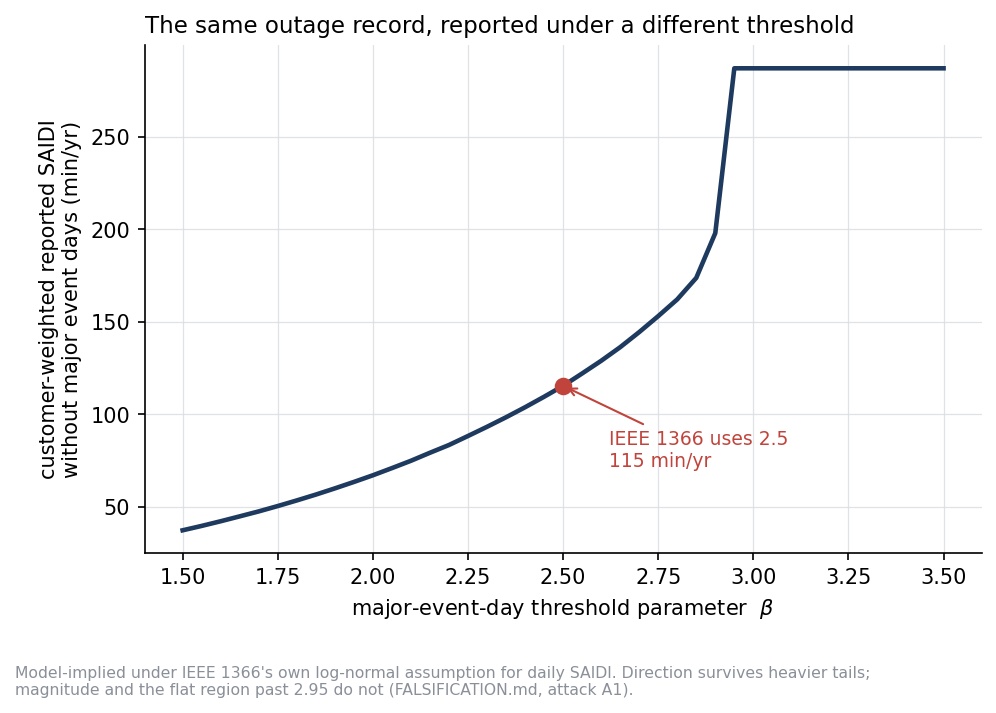
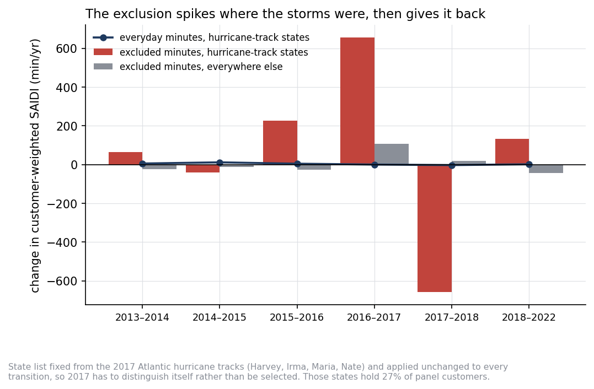
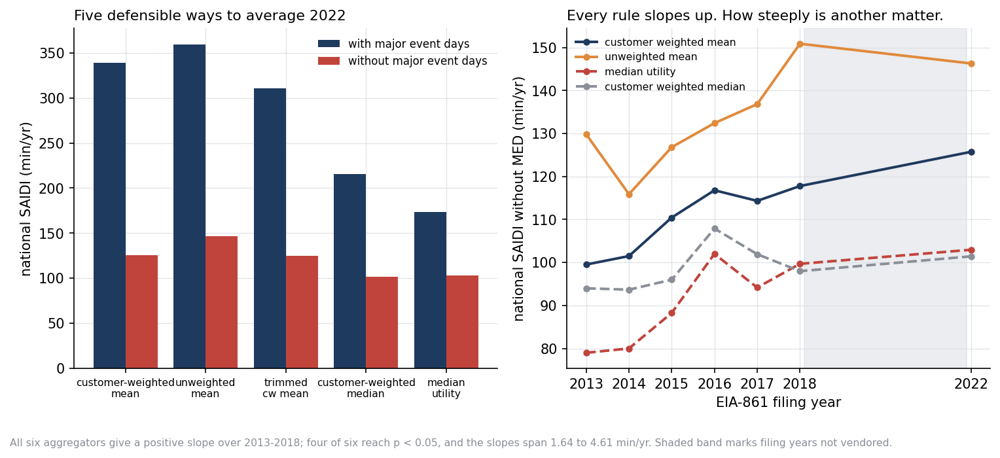

# blinkrate

[](https://github.com/ASM-21/blinkrate/actions/workflows/ci.yml)

**How much of a US utility's reported reliability number is the measurement rule
rather than the grid?**

> **Independent personal project.** Not affiliated with, reviewed by, or
> produced on behalf of PPL Electric Utilities or any employer, and not produced
> on employer time or systems. It uses only public data: EIA Form 861, which is
> a US federal government work in the public domain, plus published literature
> parameters. It contains no non-public, proprietary, customer, or
> utility-internal data of any kind.

IEEE 1366 lets utilities remove "major event days" from reported SAIDI, using a
threshold set 2.5 standard deviations up a log-normal fit to their own daily
outage history. The 2.5 was chosen by an IEEE working group comparing
alternatives on donated utility data against qualitative criteria, not derived
from any reliability outcome. This repository works out
what that choice, and the discretion around it, is worth.

**Short answer.** Under IEEE 1366's own log-normal model, re-evaluating the same
filed outage records at other threshold values moves customer-weighted fleet
SAIDI from 37 min/yr to 287 min/yr, a **7.66x range**, with no change to any
underlying outage. That magnitude is model-implied and narrows under heavier
tails; the direction does not. Sweep the averaging
rule as well, which is the second undocumented choice behind every national
figure, and the space of defensible values for one year spans **14.32x**. Nearly
a third of filings report no major event days at all, and half the large-utility
field changes quartile depending on which of the two published series someone
chose to rank on.

Put the two side by side and the thesis becomes a measurement, with conditions
attached. Under IEEE 1366's own log-normal assumption, moving the threshold from
1.5 to 3.0 changes one large utility's reported SAIDI by a median of **6.18x**,
while the whole spread between large utilities is **3.92x** from the 10th to the
90th percentile. **That comparison rests on two analyst choices, and it holds only
in one corner of them.** It is conditional on the tails of daily outages: it
needs them close to log-normal, and the IEEE literature on the method identifies
heavy right tails as its central problem. It also needs a threshold window wide enough that, at its loose end, the
standard's own model would declare about **14.7** major event days a
year. Within half a unit of the standard's 2.5, a window running from
8.3 major event days a year down to 0.5, the rule moves one
utility by less than the industry spans under every tail tested, log-normal
included.

What holds regardless is everything measured directly from the filings rather
than through the model: the zero-exclusion mass point, the rank reversal between
the two published series, the everyday deterioration trend, and the spread across
aggregation rules.

Built on 6,245 utility-state-years of EIA-861 reliability filings, 2013-2018 and
2022. Every headline number is regenerated from code and pinned by a test that
fails on drift.

```bash
pip install -e .
python -m blinkrate.run_all      # writes results/ and figures/
pytest                           # 99 tests
python tools/check_claims.py     # every quoted figure recomputed
python tools/utility_profile.py --name "Duke Energy" --figure
python tools/utility_profile.py --pair 200 120 --tails   # any filed pair
```

---

## Standing on prior work

The critique of IEEE 1366's 2.5-beta exclusion is not new here. The method's
threshold instability was identified in the IEEE literature by 2013, LBNL
evaluated alternative major-event definitions and found none uniformly reduces
year-to-year variability, and LBNL's earlier survey of 123 utilities documented
that state commissions were already using incompatible major-event definitions.
Q1 and Q2 below are national-scale **corroboration** of an established critique,
not a discovery.

What the literature search did not turn up, and what this repository therefore
contributes, is the closed-form inversion that makes the threshold sweep
possible from published annual aggregates, a quantification of rank reversal
between the two published series, the aggregation-rule spread, and the
geographic placebo separating weather from methodology. Full record of what was
searched and what it changed: **[LITERATURE.md](LITERATURE.md)**.

## Eight questions

| | Question | Answer | Basis | Confidence |
|---|---|---|---|---|
| Q1 | What is the threshold parameter worth? | 7.66x range in fleet SAIDI; the standard sits 0.45 from where the mechanism stops working | model-implied | direction solid, **magnitude assumption-dependent** |
| Q2 | Do utilities cluster where the rule rewards? | One large mass point, at *zero* exclusion (12.0x excess mass), which is the unflattering direction | filed data | solid |
| Q3 | Does the exclusion change *who* looks reliable? | 40 to 57% of large IOUs change quartile depending on which series you rank on | filed data | solid |
| Q4 | Is the decade's deterioration weather or classification? | Both, and separable: the spikes are weather, the drift into using the rule is methodology | filed data | trend **positive under every aggregator, significant under four of six**; the excluded-share figure is **mostly the Gulf coast** |
| Q5 | Does capital deployment show up in reliability? | No, and unlike the first version, the design could have caught a 24% effect | filed data | **bounded null** |
| Q6 | Does ownership predict exclusion? | Partly; one half of this was **retracted** when the panel doubled | filed data | weakened |
| Q7 | Is the source data internally consistent? | CAIDI identity reproduces in 100.00% of 3,838 filings | filed data | solid |
| Q8 | How much of the *national* number is the averaging rule? | 2.07x from the aggregator alone; **14.32x** once threshold and aggregator are swept together | filed data; combined space model-implied | solid |

Full write-up with identification and caveats: **[FINDINGS.md](FINDINGS.md)**.
Prior art and what the literature search changed: **[LITERATURE.md](LITERATURE.md)**.
How to publish it, and what was checked first: **[UPLOAD.md](UPLOAD.md)**.
What broke under attack: **[FALSIFICATION.md](FALSIFICATION.md)**.

## Three figures

**The threshold sweep** (Q1, model-implied). The same filed outage records,
re-evaluated at other values of the major-event-day parameter. The flat region
past 2.95 is a property of the log-normal assumption and disappears under
heavier tails; see attack A10 before quoting the magnitude.



**The geographic placebo** (Q4, filed data). A state list fixed from the 2017
hurricane tracks and applied to every year transition. Excluded minutes spike
where the storms were and give it back the next year, while the everyday series
in the same states does not move.



**The averaging rule** (Q8, filed data). Six defensible ways to turn the same
filings into one national number, and the trend under each.



## The method, in one paragraph

EIA-861 publishes annual SAIDI with and without major event days, never the daily
series, so no threshold can be recomputed directly. But the exclusion has a
closed form: if daily SAIDI is log-normal (the distribution IEEE 1366 itself
assumes), the share of annual outage minutes surviving exclusion is
`r = Phi(beta - sigma)`, which depends on the dispersion of daily SAIDI and on
nothing else. Not the level, not utility size. So the two published numbers pin
the one latent parameter, and the threshold can be swept on data containing no
daily series at all. Derivation in [docs/derivation.md](docs/derivation.md).

## Why you can trust the numbers

**The closed form is not what the code uses.** It is a ratio of expectations, and
a filed utility-year is one realization of 365 days; at high dispersion those
differ by up to 0.196 in retained share. The tracks invert a simulated
median-realization surface instead, which Q7 measures at 0.018 maximum error
against the procedure IEEE 1366 actually specifies. The surface is fully seeded
and rebuilds bit-identically in about 20 seconds.

**Validation runs before the findings, not after.** Q7 checks reported CAIDI
against SAIDI/SAIFI in the source, checks the closed form against the procedural
simulator, and round-trips the inversion.

**Filed data and model output are separated in the data, not just the prose.**
Every results file labels each number `filed_data` (computed straight from
EIA-861) or `model_implied` (depends on the log-normal inversion), and a result
that has not been declared refuses to save. Tests hold those labels to the
"Basis:" line on each answer in FINDINGS, so the two cannot drift apart.

**Falsification is a track, not an appendix.** Six of eleven attacks landed.
The two most recent found that the repository's own headline comparison rests on
two analyst choices, the tails of daily outages and the width of the threshold
window, and holds only in one corner of them. It was rescoped both times. Q6's
regression result was retracted outright when the panel grew. Q1's magnitude was
scoped to its distributional assumption, and the guard fails the build if that
qualifier is deleted. Leave-one-state-out found that Q4's headline share falls
from 0.829 to 0.509 when Florida alone is removed, while every other headline
moves by under 8.4% whichever state is dropped, so Q4 was rewritten to separate
a national trend from a Gulf-coast aggregate.

**More data was allowed to break things.** The panel started at four filing
years. Finding 2016-2018 nearly doubled it, retracted one published result at
p = 0.026, turned another into a range, and let two questions be answered that
were previously marked unanswerable. Nothing was re-tuned to keep an old number.

**Claims cannot drift.** `tools/check_claims.py` pairs 74 figures quoted in the
prose with the code that recomputes them, including the numbers inside
retraction blockquotes, and also fails on missing hedges and overclaiming
language. A test feeds it a corrupted README to demonstrate that the guard can
fail.

## What is missing, stated once

- **No spending variable anywhere.** FERC Form 1 is unreachable and the Form 1
  repositories on GitHub ship extraction code, not data. Q5 regresses physical
  **deployment** instead and says so; the vegetation-management question is
  marked BLOCKED rather than proxied.
- **No weather severity index.** Q4 works around this with a geographic placebo
  built from the 2017 hurricane tracks, which is suggestive but not a direct
  test.
- **No daily SAIDI at national scale**, which is why Q1 is model-implied rather
  than measured.
- **The 2019-2021 filings**, so 2022 is a single later observation rather than a
  continuation.

Search record and mirror licences: [docs/DATA_ACCESS.md](docs/DATA_ACCESS.md).

## Layout

```
blinkrate/
  shared/ingest.py              EIA-861 harmonised across three file layouts
  shared/reliability_metrics.py MED engine, tunable beta, closed form
  shared/finite_sample.py       simulated median-realization calibration
  shared/provenance.py          filed_data vs model_implied, declared per result
  track1_investment.py          Q5 capital deployment, three designs
  track2_weather_split.py       Q4 weather vs classification + geographic placebo
  track3_med_sensitivity.py     Q1-Q3 threshold sweep, bunching, ranking
  track4_cause_exclusions.py    BLOCKED (FERC); loss-of-supply substituted
  track5_undergrounding.py      breakeven model, literature parameters
  track6_ownership.py           Q6 ownership stratification
  track7_validation.py          Q7 engine and source-data checks
  track9_aggregation.py         Q8 how much the averaging rule is worth
  track8_falsification.py       eleven attacks on the above
  run_all.py
data/raw/                       vendored EIA-861 (US Gov, public domain)
docs/derivation.md              the exclusion identity
docs/DATA_ACCESS.md             provenance, licences, what is blocked
tools/check_claims.py           drift and overclaim guard
tools/utility_profile.py        run one utility's filed numbers through the engine
```

## Data

EIA Form 861, filing years 2013 through 2018 and 2022. US federal government
work, public domain, retrieved through GitHub mirrors because eia.gov is
unreachable from the build environment. Mirror attribution in [NOTICE](NOTICE).

Apache-2.0. Bundled EIA-861 data is a US federal government work in the public
domain; mirror provenance and licences are in [NOTICE](NOTICE). Citation in
[CITATION.cff](CITATION.cff).
